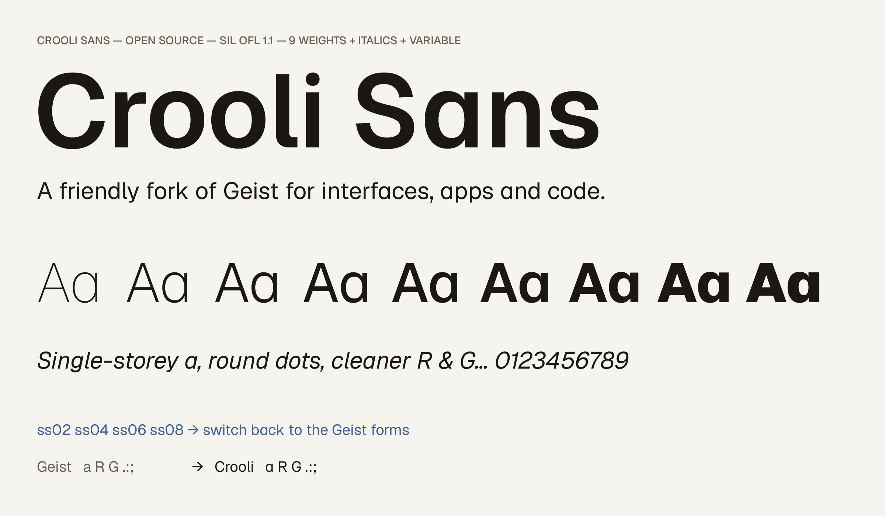

# Crooli Sans



Crooli Sans is the typeface of [Crooli](https://crooli.com). It is an open-source fork of [Geist](https://github.com/vercel/geist-font) with a friendlier default character: a single-storey **a**, round dots and punctuation, and cleaner **R** and **G**.

Every outline is Geist's own drawing. Nothing is stretched or redrawn: Crooli Sans promotes four of Geist's stylistic alternates to the default forms, and each shape keeps its spacing, kerning, accent anchors and weight variations. See it at [crooli.com/font](https://crooli.com/font).

## Styles

- 9 weights, Thin (100) to Black (900), each with an italic
- Variable fonts for upright and italic, `wght` 100–900
- Latin (including Vietnamese and Central European), Cyrillic, tabular figures, fractions, arrows

## Use it

### On the web

Copy `fonts/webfonts/CrooliSans[wght].woff2` and `CrooliSans-Italic[wght].woff2` into your project:

```css
@font-face {
  font-family: "Crooli Sans";
  src: url("/fonts/CrooliSans[wght].woff2") format("woff2");
  font-weight: 100 900;
  font-style: normal;
  font-display: swap;
}

@font-face {
  font-family: "Crooli Sans";
  src: url("/fonts/CrooliSans-Italic[wght].woff2") format("woff2");
  font-weight: 100 900;
  font-style: italic;
  font-display: swap;
}

body {
  font-family: "Crooli Sans", system-ui, sans-serif;
}
```

Static `.woff2` files for each style are in the same folder if you only need one or two weights.

### On your computer

Install the files in `fonts/ttf/` (static) or `fonts/variable/` (variable). On macOS, double-click a file and choose **Install**.

## OpenType features

The stylistic sets that Crooli Sans turns on by default now switch back to the Geist forms:

| Feature | Crooli default | With the feature on |
| --- | --- | --- |
| `ss02` | single-storey a | double-storey a |
| `ss04` | diagonal-leg R | Geist straight-leg R |
| `ss06` | spurless G | Geist G with spur |
| `ss08` | round dots | square dots |

Geist's other features work as before, including `ss01` (no-tail a), `ss03` (plain l), `ss05` (serif I), `ss07` (alternate arrows), `ss09` (slashed zero), `tnum`, `frac`, `case`, `sups` and `subs`.

```css
.figures { font-feature-settings: "tnum"; }
.geist-a { font-feature-settings: "ss02"; }
```

## Build

Crooli Sans is built from the Geist 1.800 sources in `sources/geist/`.

```bash
python3 -m venv .venv && source .venv/bin/activate
pip install -r requirements.txt -r requirements-dev.txt
python scripts/build.py
python scripts/check.py
```

`build.py` writes every font into `fonts/`. `check.py` shapes multilingual test text with HarfBuzz and confirms that each Crooli Sans style, and the variable fonts at six weights, matches Geist with the same stylistic sets on: the same outlines, advances, kerning and mark positions.

## Licence

Crooli Sans is licensed under the [SIL Open Font License 1.1](OFL.txt). You can use it, bundle it, modify it and redistribute it, in personal and commercial work. You may not sell the fonts on their own.

Crooli Sans is a modified version of Geist. Copyright 2024 The Geist Project Authors; Geist was designed by Basement.studio, Andrés Briganti and Mateo Zaragoza for Vercel. Crooli Sans is not affiliated with or endorsed by Vercel. See [FONTLOG.txt](FONTLOG.txt) for the change history.
